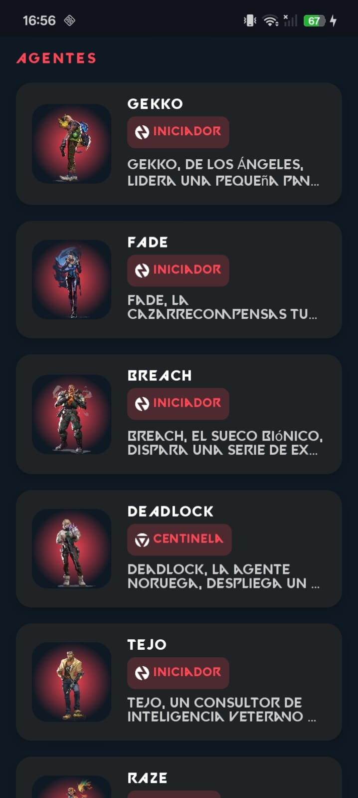
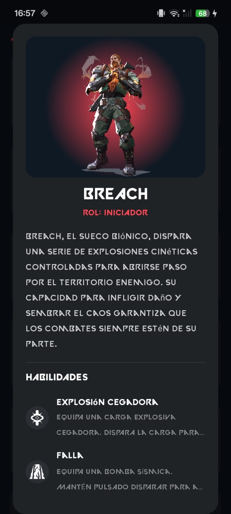

# 🗡️ VALORANT WIKI & AGENTS APP


Aplicación Android nativa desarrollada en **Kotlin** y **Jetpack Compose** que consume la API pública oficial de [Valorant-API](https://dash.valorant-api.com/). Permite explorar todos los agentes del juego, sus roles, biografías e información detallada de sus habilidades con animación interactiva en 3D e interfaz temática oscura al estilo *Riot Games*.

---

## 🖼️ Capturas de Pantalla

| Pantalla de Inicio 🏠 | Listado de Agentes 🎭 | Detalle en Pop-up 📜 |
| :---: | :---: | :---: |
|  |  |  |

---

## ✨ Características Principales

- **🏠 Pantalla de Inicio (Home):** Menú de entrada estilizado con navegación a través de `Navigation Compose` hacia la sección de personajes.
- **🎭 Catálogo de Agentes en Tiempo Real:** Carga asíncrona de todos los agentes del juego con sus nombres, roles (Duelista, Iniciador, Controlador, Centinela) y descripciones adaptadas.
- **🕹️ Imágenes Animadas 3D e Interactivas (`InteractiveAgentImage`):** Animación táctil fluida de escalado elástico (`animateFloatAsState`) y rotación 3D inclinada en el eje Y al presionar las ilustraciones de los personajes.
- **📜 Pop-up Detallado (`AgentDetailDialog`):** Diálogo emergente que se abre al seleccionar un personaje, mostrando la ilustración completa, rol, historia extendida y el desglose de todas sus habilidades con sus respectivos iconos.
- **🌐 Conexión API y Carga Óptima:** Gestión de solicitudes HTTP con **Retrofit 2** y renderizado eficiente de imágenes remotas mediante **Coil Compose** (con soporte SVG).

---

## 🛠️ Tecnologías y Librerías Utilizadas

- **Lenguaje:** [Kotlin](https://kotlinlang.org/)
- **UI Framework:** [Jetpack Compose](https://developer.android.com/jetpack/compose) con **Material Design 3** y tipografía personalizada (`valorant_font`).
- **Navegación:** [Navigation Compose](https://developer.android.com/jetpack/compose/navigation) (`androidx.navigation:navigation-compose`)
- **Peticiones HTTP & Parsing:** [Retrofit 2](https://square.github.io/retrofit/) + **Gson Converter**
- **Carga de Imágenes:** [Coil](https://coil-kt.github.io/coil/) (`io.coil-kt:coil-compose`, `coil-svg`)
- **Gestión de Estado:** `ViewModel`, `Coroutines` y `MutableState`
- **Versión mínima SDK:** Android 8.0 (API level 26)
- **Target SDK:** API level 37

---

## 📁 Estructura del Proyecto

```text
com.example.mystore/
├── data/
│   ├── model/
│   │   └── AgentResponse.kt       # Modelos JSON (AgentDto, RoleDto, AbilityDto)
│   ├── remote/
│   │   ├── ValorantApiService.kt  # Definición de Endpoints
│   │   └── RetrofitClient.kt      # Instancia Singleton de Retrofit
│   └── repository/
│       └── ValorantRepository.kt  # Capa de Repositorio de datos
├── ui/
│   ├── agents/
│   │   ├── AgentsScreen.kt        # UI de Agentes, Pop-up e imagen animada 3D
│   │   └── AgentsViewModel.kt     # Manejo de estado (Loading, Success, Error)
│   ├── home/
│   │   └── HomeScreen.kt          # Pantalla principal y menú de navegación
│   └── theme/                     # Paleta de colores, tema y tipografía (Valorant font)
└── MainActivity.kt                # Punto de entrada y configuración de NavHost
```

---

## ⚙️ Requisitos e Instalación

### Prerrequisitos
- **Android Studio** (Ladybug / Jellyfish o superior).
- **JDK 11** o superior.
- Dispositivo físico o emulador Android con **Android 8.0 (API level 26)** o superior.
- Conexión a Internet activa para consumir la API de Valorant.

### Pasos para Ejecutar
1. Clona este repositorio en tu equipo local:
   ```bash
   git clone https://github.com/Samir-Macias/valorant-app.git
   ```
2. Abre Android Studio, selecciona **Open** y busca la carpeta del proyecto.
3. Espera a que Gradle descargue las dependencias y sincronice el proyecto (`Sync Project with Gradle Files`).
4. Conecta un dispositivo físico con depuración USB o inicia un emulador Android.
5. Haz clic en el botón **Run (Shift + F10)** en la barra superior.

---

## 👤 Autor

- **Samir Macias** - *Desarrollador FullStack*
  - GitHub: [@Samir-Macias](https://github.com/Samir-Macias)
  - LinkedIn: [Samir Macias](https://linkedin.com)

---

## 📄 Licencia y Avisos Legales

- **Licencia:** Este proyecto se distribuye bajo la licencia MIT.
- **Aviso Legal de Marca:** VALORANT y todos sus activos visuales, personajes, habilidades y logotipos son marcas registradas propiedad de Riot Games, Inc.
- **Créditos de la API:** Todos los datos e imágenes expuestos son proporcionados de forma gratuita por la API comunitaria no oficial [Valorant-API](https://dash.valorant-api.com/). Este proyecto no está afiliado, respaldado ni patrocinado por Riot Games y ha sido desarrollado exclusivamente con fines educativos.
